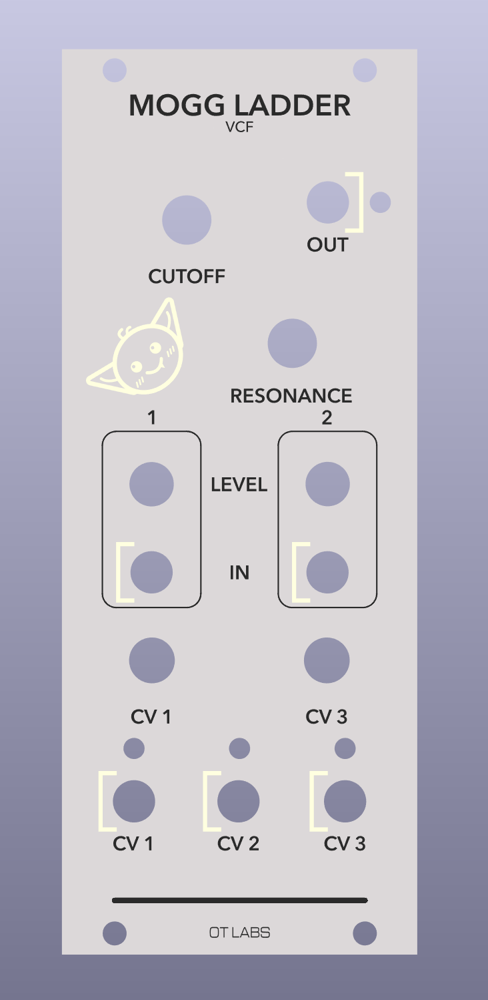

<table><tr>
<td valign="top" width="200"></td>
<td valign="top">
# Mogg Ladder
 
A Moog-style transistor ladder low pass filter, redrawn in KiCad from the [YuSynth Moog VCF](https://www.yusynth.net/Modular/EN/MOOGVCF/index.html) with values adapted for ±12V Eurorack rails. Built as two stacked boards behind the panel. Named for the Magic: The Gathering goblin, with a goblin climbing a ladder on the panel.
 
## Resources
 
- [Assembly instructions](docs/assembly.md) and [BOM](docs/bom.md)
- Interactive BOM: [front board](https://neodpt.github.io/OTLABS/Mogg%20Ladder%20VCF/ibom/mogg_ladder_front_ibom.html), [main board](https://neodpt.github.io/OTLABS/Mogg%20Ladder%20VCF/ibom/mogg_ladder_main_ibom.html)
- [Schematic](docs/mogg_ladder.pdf)
- GERBER files:
  - Faceplate: [JLCPCB](gerbers/mogg_ladder_faceplate.zip)
  - Front board: [JLCPCB](gerbers/mogg_ladder_front.zip)
  - Main board: [JLCPCB](gerbers/mogg_ladder_main.zip)
- (Most) parts on Tayda: [cart link](TAYDA_CART_URL), [quick-order CSV](docs/tayda_bom.csv)
- [KiCad source files](kicad/)
</td>
</tr></table>
## Details
 
**Status:** 🟡 Circuit working, nearly ready for fab 
**DIY difficulty:** TBD 
**HP:** 10 
**Power usage:**
 
| | Typical | Maximum |
|---|---|---|
| **+12V** | TBD | TBD |
| **-12V** | TBD | TBD |
| **+5V** | NC | - |
 
## Controls and jacks
 
| Label | Type | Function |
|---|---|---|
| Cutoff | Knob | Adjust Cutoff Frequency |
| Resonance | Knob | increases resonance |
| Audio in | Input jack | - |
| CV in | Input jack | patch in envelope|
| Audio Out | Output jack | send it |
 
## Build notes
 
- Two boards mounted back to back: a front board with the jacks and pots, and a main board with the filter core and power section, joined by 2x3 headers
- Power ribbon connects at the back board
- Power entry: header, 1N5817, 10Ω, and 10µF X7R per rail
- Pots wired so clockwise increases
## Credits
 
Circuit based on the [YuSynth Moog VCF](https://www.yusynth.net/Modular/EN/MOOGVCF/index.html) by Yves Usson. Layout and faceplate by OTLABS. The ladder topology is Robert Moog's original design.
 