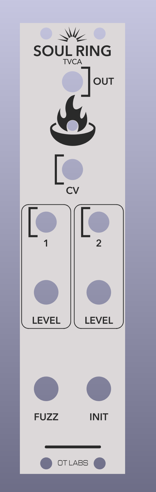

<table><tr>
<td valign="top" width="200"></td>
<td valign="top">

# Soul Ring

An LM13700 voltage controlled amplifier, redrawn in KiCad from the [Super Synthesis TVCA (rev 3)](https://github.com/supersynthesis/eurorack/tree/main/Production%20Modules/TVCA) and reworked to SMD so it fits on a single board. Named for the Magic: The Gathering artifact, with a ring of fire on the panel.

## Resources

- [Assembly instructions](docs/assembly.md) and [BOM](docs/bom.md)
- Interactive BOM: [main board](ibom/soul_ring_ibom.html)
- [Schematic](docs/tvca.pdf)
- GERBER files:
  - Faceplate: [JLCPCB](gerbers/faceplate%20TVCA.zip)
  - Main board: [JLCPCB](gerbers/mb%20TVCA%20v0.2.zip)
- (Most) parts on Tayda: [cart link](https://www.taydaelectronics.com/savecartpro/index/savenewquote/qid/60358194109), [quick-order CSV](docs/tayda_bom.csv)
- [KiCad source files](kicad/)
- [VCV Rack 2 module](https://library.vcvrack.com/SFSSuper/TVCA)

## Details

**Status:** 🟡 Nearly ready for fab 
**DIY difficulty:** TBD (SMD, 0805 and larger) 
**HP:** 6 
**Power usage:**

| | Typical | Maximum |
|---|---|---|
| **+12V** | TBD | TBD |
| **-12V** | TBD | TBD |
| **+5V** | NC | - |

## Controls and jacks
| Label | Type | Function |
|---|---|---|
| 1 | Input | Jack Channel 1 in |
| 2 | Input | Jack Channel 2 in |
| LEVEL 1 | Knob | Channel 1 level |
| LEVEL 2 | Knob | Channel 2 level |
| CV | Input Jack | patch in an envelope |
| OUT | Audio Output | Jack |
| FUZZ | Knob | increased amplifictation and distoration |
| INIT | Knob | where the level starts|

## Build notes

- Single SMD board, reworked from my earlier two-board through-hole version
- Power entry: header, 1N5817, 10Ω, and 10µF X7R per rail

## Credits

Circuit based on the [TVCA by Super Synthesis](https://github.com/supersynthesis/eurorack/tree/main/Production%20Modules/TVCA). Layout and faceplate by OTLABS. See the original repo for its license.
</td>
</tr></table>

 